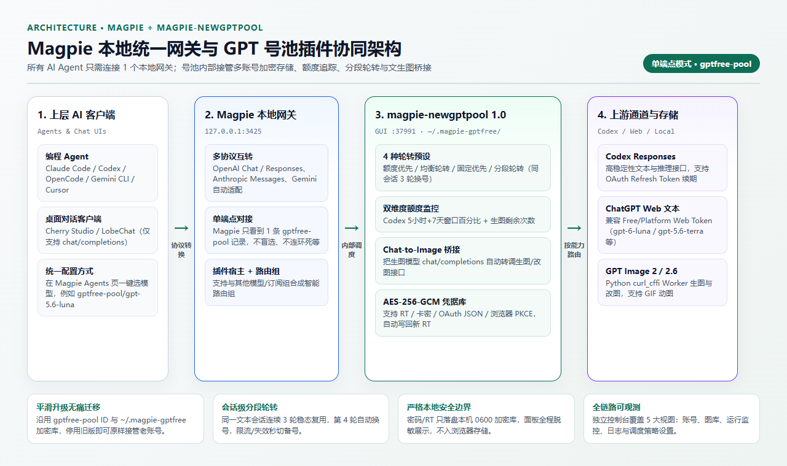
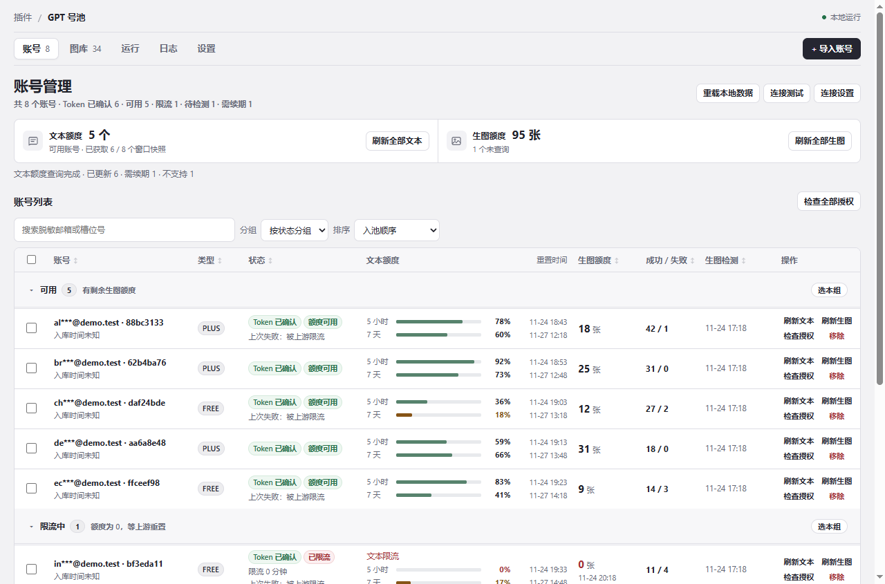
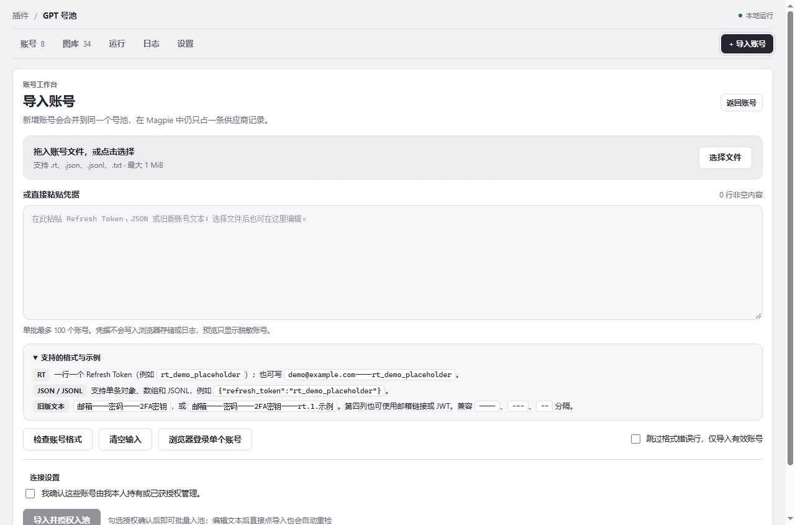
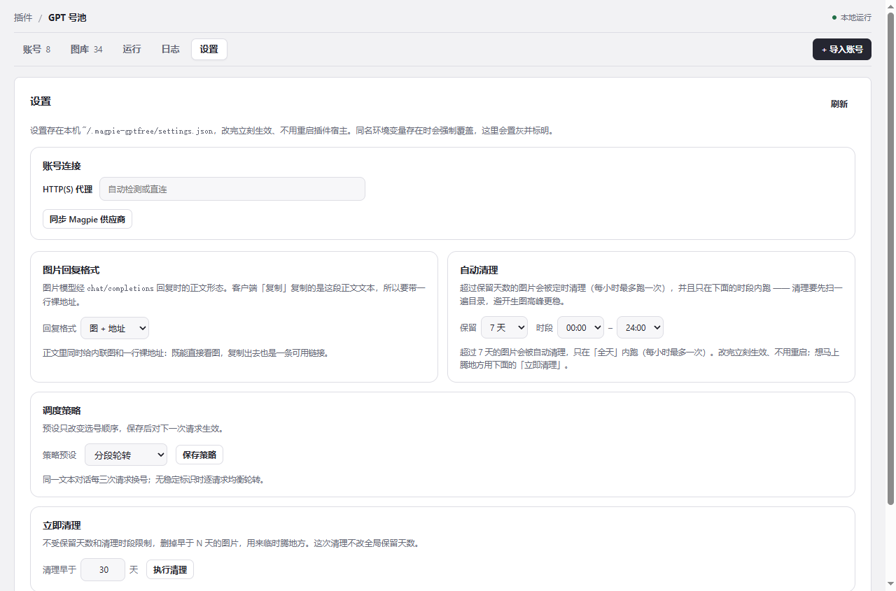
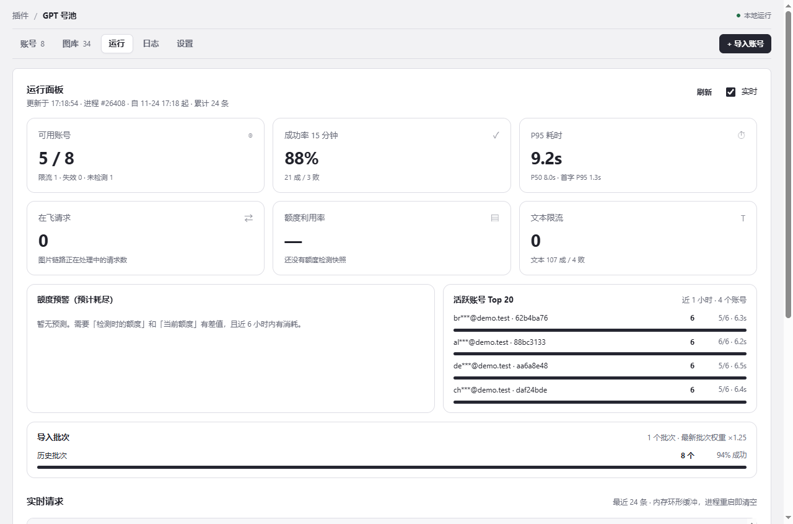
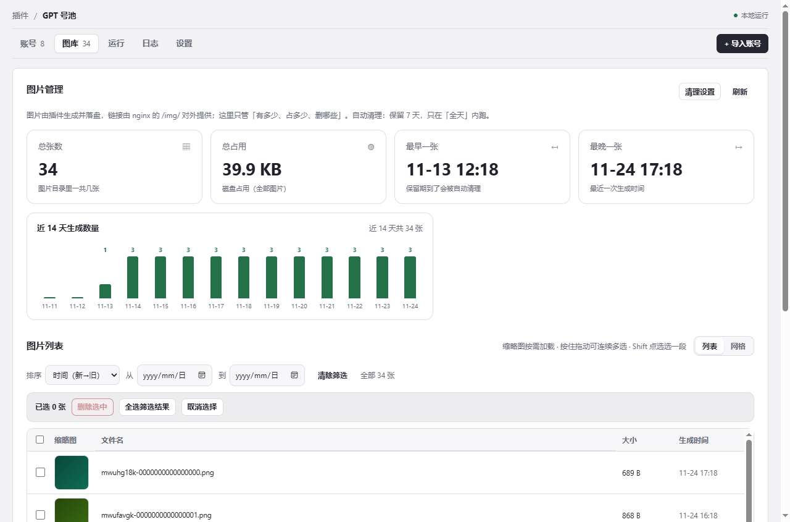

# magpie-newgptpool · GPT 号池 Magpie 插件

[](./LICENSE)
[](./package.json)
[](./package.json)

**`magpie-newgptpool`**（目录：`magpie-newgptpool-1.0`，版本 `1.0.0`）是一款为 **[Magpie](https://github.com/yetone/magpie)** 打造的增强型 ChatGPT / Codex 多账号号池插件。基于 [magpie-gptpool 0.12.10](https://github.com/puaicg/magpie-gptpool)，沿用 [MIT 许可证](./LICENSE)。

它把多账号的**加密存储、多格式导入、双维度额度观测、智能分段轮转、Chat-to-Image 绘图桥接与独立控制台**封装在插件内部，在 Magpie 中只以**单个供应商端点（`gptfree-pool`）**呈现，让 Claude Code、Codex、OpenCode、Gemini CLI、Cherry Studio、LobeChat 等上层客户端像调用一个高可用网关一样无缝使用整个号池。

---

## 一、先认识 Magpie：为什么从它开始？

如果你同时使用多个 AI 编程工具或对话客户端，往往会遇到这样的割裂体验：
- 每个 Agent 的配置文件、Key 格式和 Base URL 各管各的；
- 某个账号或订阅额度用完时，客户端直接报错中断；
- 图像模型只提供 `/v1/images/*` 端点，而多数桌面对话端只调用 `/v1/chat/completions`。

**[Magpie](https://github.com/yetone/magpie)**（*Every agent's model. One place.*）把这些问题收进了一个本地应用与统一本地网关：
- 支持 OpenAI、Anthropic、Gemini 等多协议互转，跨 macOS / Windows / Linux / Docker / Termux 运行；
- 统一接管 Agent 配置、模型列表、路由组与本地隐私脱敏；
- 提供插件机制，允许以 `magpie plugin add` 的方式扩展自定义 Provider、鉴权流与独立管理界面。

而 `magpie-newgptpool` 正是运行在 Magpie 插件宿主之上的**单端点 GPT/Codex 号池引擎**。

---

## 二、协同架构与核心优势

早期将几十上百个账号直接注册为独立供应商记录时，宿主无法感知各账号的真实剩余额度与限流冷却状态，往往会触发盲目重试。`magpie-newgptpool` 采用**单端点汇聚架构**：



1. **单端点对外，内部全权调度**：Magpie 侧仅保留 1 条 `gptfree-pool` 记录，全池统一并发上限为 `4`，选号、冷却、熔断与 401 自动续期全部由插件内部完成。
2. **双通道上游路由**：
   - **Codex Responses**：高稳定性文本与推理接口，支持 OAuth Refresh Token 自动轮换续期；
   - **ChatGPT Web 文本**：兼容 Free / Platform Web Token（支持 `gpt-6-luna`、`gpt-5.6-luna`、`gpt-5.6-terra`、`gpt-6`、`gpt-5-6`、`gpt-6-mini`、`gpt-5-6-mini`、`gpt-6-t-mini`、`gpt-5-6-t-mini`、`auto`）；
   - **GPT Image 2 / 2.6 生图与改图**：通过 Python `curl_cffi` Worker（`image_worker.py`）接入 `picture_v2` 管线，支持 `gpt-image-2`、`gpt-image-2.6`、`gpt-image-2.6-flare`、`gpt-image-2.6-sunburst`，支持文生图、图生图改图及 `2.6` 系列 GIF 动图输出。
3. **Chat-to-Image 桥接**：自动将 `/v1/chat/completions` 上发起的生图/改图请求桥接到图片生成管线，并支持在设置中切换回复形态（内联图 + 裸链接等），让只支持聊天接口的客户端直接出图。

---

## 三、控制台功能一览（图文演示）

插件内置独立本机管理面板（默认端口 `37991`，通过沙盒化入口与一次性能力令牌隔离鉴权），包含五大视图：

### 1. 账号管理与双维度额度监控



- **文本额度**：支持单个或「刷新全部文本」分批读取 Codex 上游 5 小时短窗与 7 天长窗剩余比例及重置时间，遇上游限流自动退避。明确区分「待查询 / 不可用 / 已过期 / 历史快照 / 真实归零」，快照保留在插件进程内（超过 15 分钟或重启后需重新刷新），只读查询不发聊天请求。
- **生图额度**：支持单个、所选或全部账号纯查询生图剩余次数（`quotaOnly`），不消耗或轮换 RT；刷新失败时保留最近一次成功值并标记为历史值。
- **检查授权与连接测试**：可对单个、所选或全部账号执行按需续期与生图探测；连接测试可检测 ChatGPT 网络可达性并按条件抽查未过期 Codex 授权。
- **重载本地数据**：仅读取本地加密库、快照与任务进度，不向网络发起请求。

### 2. 多格式批量导入与安全预览



在面板点击「**+ 导入账号**」即可进入账号工作台：
- **单个账号**：支持标准 OAuth PKCE（S256 + `state` CSRF 校验）浏览器授权。
- **批量导入（支持 TXT / RT / JSON / JSONL 拖拽或粘贴，单批最多 100 个）**：
  - **RT**：每行一个 Refresh Token；带 `rt_`、`rt-` 或 `rt.1.` 等版本化前缀时支持 `邮箱----RT`，无明确前缀时可用制表符、竖线或逗号指定邮箱，避免与旧版 `邮箱----密码` 冲突。
  - **OAuth JSON / JSONL**：兼容 Codex/CPA 凭据、Codex `auth.json` 的 `tokens`、Sub2API `accounts[].credentials`、JSON 数组或逐行 JSON。
  - **卡密文本**：`邮箱----密码----TOTP----访问令牌` 或 `邮箱----密码----TOTP----RT`（第四列为 RT 时直接走 RT 授权，随行密码与 TOTP 不落库）。
- **无损预览**：点击「检查账号格式」（或 CLI `--dry-run`）只做本地解析与脱敏预览，绝不提前消耗或轮换 RT。
- **本地安全边界**：凭据使用 AES-256-GCM 加密保存于 `~/.magpie-gptfree/pool.enc.json`（密钥 `~/.magpie-gptfree/master.key`，权限 `0600`，容量上限 1000 个账号）；面板全程脱敏展示，不将任何凭据或代理配置写入浏览器存储。

### 3. 四种轮转预设、回复格式与自动清理设置



设置实时持久化至 `~/.magpie-gptfree/settings.json`，保存后立即对下一次请求生效，无需重启宿主：
- **调度策略预设**：
  - **额度优先（`quotaFirst`）**：按已知生图额度与健康信号加权选号；Codex 文本窗口快照仅供观测，不参与生图权重计算。
  - **均衡轮转（`roundRobin`）**：可用账号等权轮流使用，冷却中的账号自动后移。
  - **固定优先（`preferred`）**：按入池顺序优先复用首个可用账号，失败自动故障转移。
  - **分段轮转（`segmented`）**：同一文本会话连续 3 轮固定使用当前账号，第 4 轮自动切换；不同新会话分散起步；遇限流或失效秒切备号；无稳定会话标识时等权轮转；生图继续走额度优先。
- **账号连接**：支持设置仅当前页面会话有效的临时 HTTP(S) 代理（用于导入、浏览器授权与生图检查），以及一键「同步 Magpie 供应商」。
- **图片回复格式与清理**：可配置 `chat/completions` 桥接返回形式，以及保留天数、每日安全清理时段与临时「立即清理」。

### 4. 实时运行监控面板



- 实时观测可用账号数、15 分钟成功率、P50 / P95 / 首字 TTFB P95 耗时、在飞请求数、文本限流统计；
- 提供**额度耗尽预警**、**近 1 小时活跃账号 Top 20**、**导入批次健康度**与内存环形缓冲的实时请求流（勾选`实时`自动刷新）。

### 5. 图片管理与近 14 天生成趋势



- 统计本地落盘图片总数、磁盘占用、最早/最晚生成时间及近 14 天每日生成柱状图；
- 支持按日期区间筛选、列表/网格视图切换、按住拖动与 Shift 区间多选删除，并附带自动清理日志与图片错误日志查看。

---

## 四、安装与升级

1. **停用旧版（如已安装）**：如果 Magpie 中已启用旧版 `magpie-gptpool`，请先停用旧版再安装新版。新版保留供应商 ID `gptfree-pool` 和原有加密账号库（默认 `~/.magpie-gptfree/`），无需重新导入旧账号，也请勿同时启用两个版本。
2. **安装插件**（在仓库目录或上级目录执行）：

   ```sh
   magpie plugin add .
   ```

   如果是在上级目录使用带版本号的目录名，可执行：

   ```sh
   magpie plugin add ./magpie-newgptpool-1.0
   ```

   如果你的 Magpie 版本支持在界面中添加本地插件，也可直接在界面中选择本插件目录。
3. **打开控制台**：在 Magpie 中进入「**GPT 号池**」页，面板服务默认监听本机 `127.0.0.1:37991`。
4. **Python Worker 依赖**（用于生图与密码授权）：如果运行环境中未配置 Python 依赖，按 [python/requirements.txt](./python/requirements.txt) 安装即可；未安装 Python 依赖不影响账号格式预览、RT 导入或 Codex 文本额度读取。

---

## 五、本地校验与维护

在本目录运行：

```sh
# 检查全部 JS 模块语法
npm run check

# 运行 Node.js 自动化测试套件
npm test

# 运行 Python Worker 单元测试
npm run test:python

# 离线检查账号文件格式（不消耗/不轮换 RT）
node bin/import.mjs --file <账号文件> --dry-run
```

> 安全提醒：切勿将真实卡密、Refresh Token、`pool.enc.json` 或 `master.key` 放入插件目录或提交到 Git 仓库。更多维护契约与排障说明见 [MAINTENANCE.md](./MAINTENANCE.md) 与 [CHANGELOG.md](./CHANGELOG.md)。
